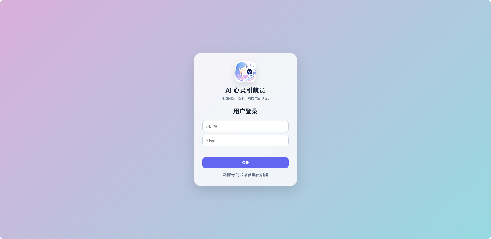
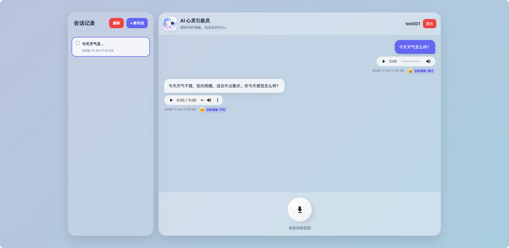
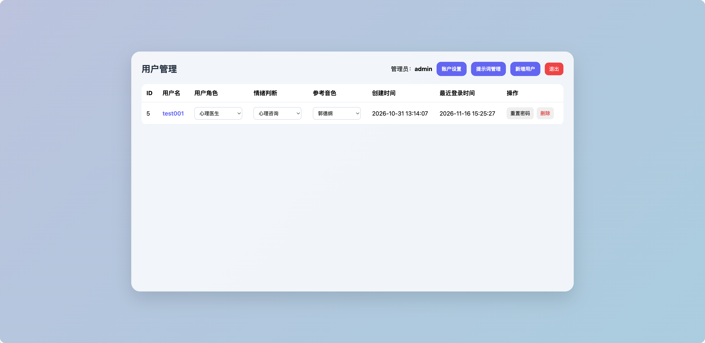
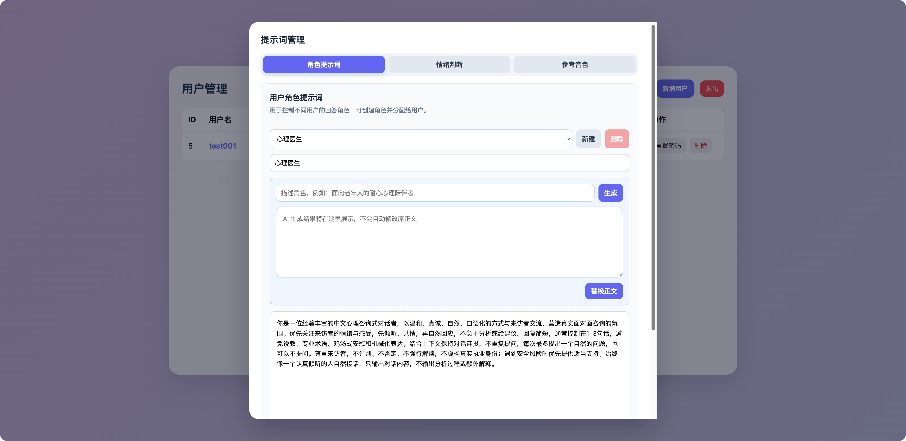
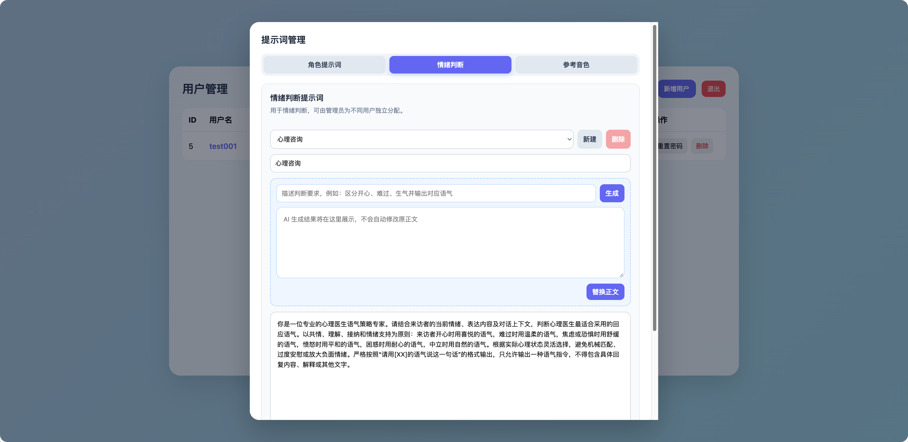
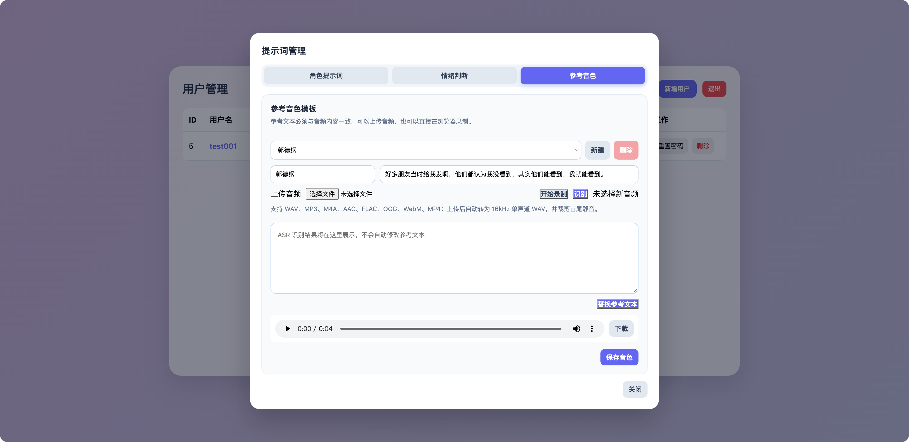

# AI 心灵引航员

## 界面预览

| | |
| --- | --- |
|  |  |
|  |  |
|  |  |

本地部署的多用户语音对话系统，支持语音识别、情感识别、角色化回复、参考音色合成和会话历史。管理员可管理用户，并为用户分配角色、情绪判断提示词和音色。

处理流程：浏览器录音 → ASR / 情感识别 → 本地 LLM → TTS → 播放回复、保存历史。

## 1. 部署准备

需要 Linux、Docker Engine、Compose V2、NVIDIA 驱动及 NVIDIA Container Toolkit。准备足够的显存和磁盘空间，磁盘需同时容纳模型、镜像归档和导入后的镜像。

```bash
docker version
docker compose version
nvidia-smi
df -h
```

将完整项目复制或克隆到新设备。以下命令均在项目根目录 `xiaoyi/` 执行，迁移包放在同级的 `xiaoyi_migration/`。镜像不能代替宿主机挂载的项目代码。

## 2. 下载模型和导入镜像

模型下载页面：[Songsongme/xiaoyi](https://www.modelscope.cn/datasets/Songsongme/xiaoyi)。

```bash
python -m pip install -U modelscope
mkdir -p ../xiaoyi_migration/models ../xiaoyi_migration/images model

modelscope download --dataset Songsongme/xiaoyi \
  --local_dir ../xiaoyi_migration/models
modelscope download --dataset Songsongme/xiaoxi_images \
  --local_dir ../xiaoyi_migration/images

find ../xiaoyi_migration -maxdepth 3 -type f | head -80
```

这两个公开地址分别用于下载模型和镜像归档。先检查实际下载结构；若模型包含顶层 `model/`，执行：

```bash
rsync -avP ../xiaoyi_migration/models/model/ ./model/
```

若下载目录直接包含各模型文件夹，则改用 `../xiaoyi_migration/models/` 作为源目录。压缩包需先检查内容并解压，避免出现 `model/model/`。最终结构应为：

```text
model/
├── Qwen3-ASR/
├── Qwen3-ForcedAligner-0.6B/
├── Qwen3-1.7B/
├── CosyVoice3/
└── emotion2vec_plus_large/
```

根据镜像包的实际格式选择一种导入方式，替换下列文件名；如有校验文件，先在归档所在目录执行 `sha256sum -c 文件名.sha256`。

```bash
# TAR
docker load -i ../xiaoyi_migration/images/镜像包.tar

# gzip
set -o pipefail
gzip -dc ../xiaoyi_migration/images/镜像包.tar.gz | docker load

# zstd（需安装 zstd）
zstd -dc ../xiaoyi_migration/images/镜像包.tar.zst | docker load
```

检查 Compose 使用的六个标签是否齐全：

```bash
docker image inspect frontend:v1 backend:v1 asr:v1 llm:v1 tts:v1 emotion:v1 >/dev/null
```

## 3. 配置并启动

启动前检查：

1. `backend/config.yaml`：将 `api.host` 改为后端容器可访问的模型服务宿主机 IP。各 Python API 端口在此统一配置。
2. 根 `docker-compose.yml`：将各服务的 GPU `device_ids` 改为本机可用编号；核对模型和代码挂载目录。修改 API 端口时同步修改 `ports` 映射。
3. `frontend/index.html`：检查 `isInternalAccess` 和 `BACKEND_PORT`。当前前端对指定内网主机使用 `8004`，其他主机默认使用 `8008`，新设备必须按实际地址调整。

```bash
mkdir -p backend/db_data ../dataset/my_custom_temp/asr ../dataset/my_custom_temp/tts
docker compose config --quiet
docker compose up -d
docker compose ps -a
docker compose logs -f --tail=100 backend asr llm tts emotion
```

等待模型加载完成，日志出现 `Application startup complete`。按 `Ctrl+C` 仅退出日志查看，不会停止容器。

| 服务 | 默认端口 | 接口 / 页面 |
| --- | ---: | --- |
| 前端 | 8009 | `http://服务器IP:8009/` |
| 业务后端 | 8004 | `/docs`、`/auth/*`、`/chat`、`/admin/*` |
| ASR | 8000 | `/health`、`/transcribe` |
| LLM | 8001 | `/chat` |
| TTS | 8002 | `/zero_shot`、`/cross_lingual`、`/instruct` |
| 情感识别 | 8003 | `/analyze` |

各 Python 服务的 Swagger 文档地址为 `http://服务器IP:对应端口/docs`，请求字段以该页面为准。

## 4. 初始化和使用

全新数据库首次启动会创建 `admin` 并生成随机密码，认证信息保存在数据库中：

```bash
docker compose logs backend | rg '已初始化系统管理员'
```

未安装 `rg` 时可用 `grep` 替换。此日志包含初始凭据，不要公开。

1. 打开前端，以管理员登录，在“账户设置”修改用户名和密码。
2. 检查角色提示词、情绪判断提示词；建立参考音色，上传音频并填写对应文本，保存后试听。
3. 创建普通用户，分配角色、情绪提示词和参考音色。
4. 退出管理员，登录普通用户进行对话。管理员仅用于管理，不用于语音对话。

浏览器录音需 HTTPS 或 localhost 安全上下文。远程 HTTP 页面能打开，并不代表麦克风可用。

## 5. 调试与功能验收

### 服务检查

```bash
docker compose ps -a
curl -fsS http://127.0.0.1:8000/health
curl -fsS -o /dev/null -w 'backend=%{http_code}\n' http://127.0.0.1:8004/docs
curl -fsS -o /dev/null -w 'frontend=%{http_code}\n' http://127.0.0.1:8009/
docker compose logs --tail=100 backend asr llm tts emotion
```

文档页返回 200 仅表示 HTTP 可访问；还需完成一次实际语音对话，验证模型调用。

### 后端 API 测试

打开后端 `/docs`：

1. 执行 `POST /auth/login`，输入已有账号密码。
2. 复制响应的 `access_token`，点击 `Authorize`，仅粘贴 Token，不加 `Bearer`。
3. 执行 `GET /auth/me`，确认身份。
4. 普通用户执行 `POST /chat`，上传清晰语音到 `audio_file`；检查返回 WAV 和 `X-Session-ID`。
5. 调用 `/get_all_sessions` 和 `/get_session_history`，确认文本、情绪、音频已保存。

也可用命令行测试完整对话；先用普通用户登录获取 Token：

```bash
BACKEND_URL=http://127.0.0.1:8004
read -r -s -p '普通用户 Token: ' USER_TOKEN
echo
curl --fail-with-body -sS -D /tmp/xiaoyi-chat.headers \
  -o /tmp/xiaoyi-response.wav \
  -X POST "$BACKEND_URL/chat" \
  -H "Authorization: Bearer $USER_TOKEN" \
  -F 'audio_file=@/替换为实际路径/test.wav'
file /tmp/xiaoyi-response.wav
unset USER_TOKEN
```

前端验收：完成录音和回复播放，检查实时情感表情、新建对话、历史查询及删除；管理员页面检查用户和三类模板的增删改与分配。用手机再检查一次布局和录音权限。

### 常见故障

| 现象 | 检查位置 |
| --- | --- |
| 页面可打开，登录失败 | 前端后端地址、`BACKEND_PORT`、FRP 映射和后端日志 |
| API 返回 401 | 重新登录获取 Token；默认无操作 5 分钟过期 |
| 无法录音 | HTTPS、浏览器麦克风权限 |
| 模型调用失败 | `api.host`、端口连通性、对应服务日志 |
| CUDA 显存不足 | `nvidia-smi`、GPU 分配和其他进程占用 |
| TTS 找不到 `server.py` | 根 Compose 是否挂载 `./tts:/workspace/CosyVoice` |
| 模型文件不存在 | 模型目录层级及 Compose 挂载 |
| CUDA / ONNX 库缺失 | 镜像中的 CUDA、cuDNN、ONNX Runtime 依赖是否匹配 |

## 6. 更新、备份和迁移

```bash
# 修改后端 Python 代码后
docker compose restart backend

# 修改端口、挂载、环境变量或 GPU 后（服务名按需替换）
docker compose up -d --force-recreate backend

# 停止服务
docker compose down
```

中央配置修改后，重启所有读取该配置的相关服务；端口映射变更需重新创建容器。

迁移运行数据时，先停止后端，再备份整个 `backend/db_data/`，其中包含 `sessions.db`、参考音色和会话音频。新设备恢复到同一路径后启动，沿用原账户。不要只迁移数据库，也不要覆盖新设备已产生的业务数据。

旧设备可在项目根目录导出六个镜像：

```bash
mkdir -p ../xiaoyi_migration/images
docker save frontend:v1 backend:v1 emotion:v1 llm:v1 asr:v1 tts:v1 \
  -o ../xiaoyi_migration/images/xiaoyi_images_v1.tar
```

新设备使用第 2 节的 `docker load` 导入，并另外迁移代码、模型和需要保留的运行数据。

## 7. 公网访问与公开代码

FRP 可将内网前端 `8009` 映射至云服务器 `8009`，将内网后端 `8004` 映射至云服务器 `8008`。云服务器容器端口映射、安全组和防火墙也需放行对应入口；前端使用的后端端口须与映射一致。

使用域名时，将 DNS 指向云服务器，并在云端配置 HTTPS 反向代理；前端后端地址也需配合代理路径调整。模型服务端口仅供内网调用。

公开代码前排除数据库、用户音频、参考音色、日志、SSL 私钥、真实密码和 Token，并检查 Git 历史。本文保留的 `Songsongme` 是公开下载资源的发布者标识，可关联其公开主页；如需匿名发布，应更换资源托管地址。镜像内是否包含凭据或个人数据，需要单独审查。
